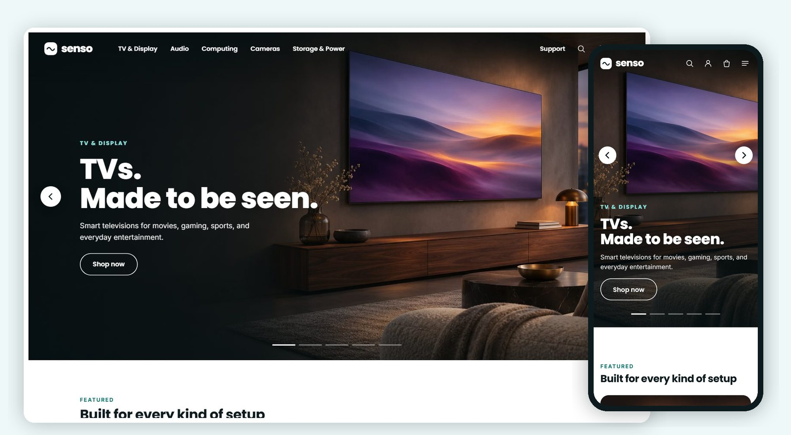

<p align="center">
  
</p>

<h1 align="center">Senso Electronics</h1>

<p align="center">
  <b>A calm, cinematic brand-site storefront for a Selldone electronics shop.</b><br>
  A custom Selldone Layout built on the official <a href="https://github.com/selldone/storefront">selldone/storefront</a>.
</p>

<p align="center">
  <a href="https://senso.selldone.shop"></a>
  <a href="https://github.com/selldone-custom-layouts/official-senso/wiki"></a>
  <a href="https://github.com/selldone-custom-layouts/official-senso/wiki/Install-with-AI"></a>
  
  
</p>

<p align="center">
  <a href="https://senso.selldone.shop"><b>Open the live shop</b></a> ·
  <a href="https://github.com/selldone-custom-layouts/official-senso/wiki/Install-with-AI">Set it up with AI</a> ·
  <a href="https://github.com/selldone-custom-layouts/official-senso/wiki/Manual-Setup">Manual setup</a> ·
  <a href="https://github.com/selldone-custom-layouts/official-senso/wiki/Shop-Requirements">What your shop needs</a> ·
  <a href="https://github.com/selldone-custom-layouts">All Selldone custom layouts</a>
</p>

---

## What it is

**Senso Electronics** dresses a single-seller electronics shop like a premium electronics **brand site**: calm, spacious and cinematic.

- Big full-bleed imagery and lots of white space.
- Bold geometric headings in Poppins, each under a small teal eyebrow in capitals.
- One teal for every button: solid pills with white words, outlined teal pills, and outlined white pills on photos.
- Pale mint tiles behind the product cut-outs, and 18–20px corners on cards and tiles.
- Thin teal line icons drawn for Senso, a wordmark and mark of its own, and no line under any word or icon.

It runs on **[senso.selldone.shop](https://senso.selldone.shop)**, an address of the Selldone shop Digini. Selldone lets each domain of a shop carry its own Layout.

Selldone's own cart, checkout, payments and orders keep working underneath. Nothing about the shop is hard-coded. The name is one line in `kalio-brand.ts`. Categories, product families, products, prices, deals and their end dates, tags and articles all come from the shop that runs it.

## Highlights

- **Header:** clear over the dark hero with white words, then solid white with a hairline once the page scrolls (solid on every other page).
  - The wordmark on the left.
  - The product **families** in the middle, built from the live categories (TV & Display, Audio, Computing, Cameras, Storage & Power, and "More" for anything else). Each family opens a clean mega panel on a click: its categories with line icons and price lines, and one featured product. There is no scrim.
  - On the right: Support, a search icon that opens a full-width search panel with suggestions and the categories, Account, Theme and the cart.
  - On a phone: the wordmark and icons. The menu is a full-screen panel with the families as accordions. There is never a bottom tab bar.
- **Home:**
  - a full-bleed hero carousel, about 85% of the screen, with one slide per family ("TVs. Made to be seen."), round white arrows and a thin progress bar. It pauses on hover, off the screen and with reduced motion;
  - **FEATURED** and **LIFESTYLE**: a wide rounded image card telling a family's story, over a row of pale tiles, each with a category's name and its showcase product as a large cut-out;
  - **COLLECTIONS**: one tab per tag in use (best sellers first). A new tag makes a new tab, and an empty tag shows nothing;
  - **DEALS** "Offers worth a closer look": the biggest savings;
  - **CATEGORY** "Shop the latest": every category as a line-icon tile;
  - **NEW** "Just arrived": from the new-arrival tag, hidden when empty;
  - **STORIES**: the four newest articles as large image cards;
  - the newsletter form, using Selldone's own subscription.
- **Cards:** a white rounded card with the packshot on a soft grey well, and colour swatches (a click picks the colour the cart button adds) or capacity chips.
  - Below them: the bold name, the price with "Was" and a red "Save $X", and a quiet "Ends in …" line counting to the deal's own end date.
  - Then a solid **Add to cart** pill that becomes "− n in cart +" in place, or **Choose options** for products whose capacities have their own prices.
  - In listings, an outlined **Learn more** sits beside it. Last comes a Compare checkbox.
- **Category, search and offers pages:** on a light grey ground.
  - A dark banner with the headline, the family photo (or a placeholder holding the category's showcase product) and the deals clock on the offers page.
  - The category's kinds as white rounded chips: a spec such as Display or Screen, else its brands. A click filters the list.
  - "N RESULTS" and a rounded Sort pill.
  - A white filter card with collapsible groups (On sale, Price, Colour, the category's own spec filters, Brand), and three cards a row. On a phone the filters open in a full sheet.
  - Loading keeps the cards and dims them, with an "Updating results…" pill. New cards fade up. The first load shows skeletons in the card's shape.
- **Product page:**
  - the gallery on the left (one row of thumbnails) beside a sticky info column: category eyebrow, name, brand and model, colour or capacity chips with their own prices, price and saving, the deal's real clock, stock, Add to cart, Compare, Save, and the shop's delivery lines;
  - **Highlights** bands written from the product's own article and spec;
  - **Specifications** as a clean two-column table in the shop's own groups;
  - **Compare with similar**: three products of the category side by side;
  - Reviews, Frequently bought together, and **You may also like**.
- **Support centre:** FAQ with a search box, quick tiles and the questions as accordions. Contact, About, Terms, Privacy, the blog, the 404 (a big headline and the category tiles), the compare page, the cart drawer and page, checkout, the order page and the account (design "desk") are all in the same dress.
- **Theme (showcase only):** on Senso's own showcase shop, the header's Theme button offers five tested palettes, a free **Custom colour** and Light / Dark. Dark mode is complete.

## Photos

Every lifestyle photo slot is listed in one file, [`components/senso/senso-photos.ts`](components/senso/senso-photos.ts): the hero slides, the home's two wide cards, the category banners, the Highlights cards, About and Support. Each slot uses `assets/senso/photos/<file>` when that file exists at build time.

Until then it shows a designed placeholder: a calm tinted panel of the slot's exact shape, a small photo icon and the file name. The hero uses the shop's own wide category photos (`assets/senso/wide-<category>.webp`) meanwhile. Drop the photos in, build and release; no code changes.

## Use it on your shop

| You want to… | Read |
| --- | --- |
| Let an AI agent (Claude Code, Codex…) set it up for your shop | [Install with AI](https://github.com/selldone-custom-layouts/official-senso/wiki/Install-with-AI) |
| Do it yourself, step by step | [Manual Setup](https://github.com/selldone-custom-layouts/official-senso/wiki/Manual-Setup) |
| Know what data your shop needs for the design to look right | [Shop Requirements](https://github.com/selldone-custom-layouts/official-senso/wiki/Shop-Requirements) |
| Build, upload and verify a release | [Build and Upload](https://github.com/selldone-custom-layouts/official-senso/wiki/Build-and-Upload) |
| Put the Layout live on your shop, or on one domain of it | [Go Live](https://github.com/selldone-custom-layouts/official-senso/wiki/Go-Live) |
| Change colours, fonts, photos, families, sections or pages | [Customize](https://github.com/selldone-custom-layouts/official-senso/wiki/Customize) |
| Fix a blank page, a rejected upload or an old version showing | [Troubleshooting](https://github.com/selldone-custom-layouts/official-senso/wiki/Troubleshooting) |

The wiki's source is also in [`docs/wiki/`](docs/wiki/).

### Theme and colours

Choose Senso's colours in one file, `components/senso/senso-theme.settings.ts`:

- `palette`: teal (the default), ocean, violet, forest or ember;
- or `brandColor`: any `#RRGGBB`, made readable automatically (`textOnBrand: "auto"` keeps a light brand such as yellow, with dark words on its buttons);
- `mode`: light or dark;
- `themeSwitcher`: showcase, on or off.

You can also tell your AI agent "use the yellow theme" or "make it dark": `AGENTS.md` (section "Theme") tells it what to change. Then build and upload. See the wiki page [Theme and colours](https://github.com/selldone-custom-layouts/official-senso/wiki/Theme-and-colours).

The header's Theme button is a showcase feature. It shows only on Senso's own showcase shop (Selldone shop 15549), so when you import Senso into your shop, your shoppers see Senso in its designed teal, with no Theme button. The Layout looks exactly as it does without the switcher, and any stored choice is ignored.

To offer the switcher to your shoppers, set `themeSwitcher: "on"`, then build and upload. `themeSwitcher: "off"` hides it everywhere.

## Quick start (developers)

```bash
git clone https://github.com/selldone-custom-layouts/official-senso.git
cd official-senso
npm run setup            # Selldone's modules
npm install --force
npm run serve            # dev server on http://localhost:9133
```

Point `.env` at your shop (`VITE_APP_SAMPLE_SHOP_NAME`). Releases: `bash scripts/release.sh <new-version> desk`. See [Build and Upload](https://github.com/selldone-custom-layouts/official-senso/wiki/Build-and-Upload).

## Where things are

| Area | Files |
| --- | --- |
| The home sections, card, rails, hero, mega panel, listing head, filter card, product overview, Highlights, compare with similar | [`components/senso/`](components/senso/) |
| Product families (from the live categories) and the line icons | [`senso-families.ts`](components/senso/senso-families.ts), [`senso-icons.ts`](components/senso/senso-icons.ts) |
| The photo slots | [`senso-photos.ts`](components/senso/senso-photos.ts), [`assets/senso/photos/`](assets/senso/photos/) |
| The name and logo (one place) | [`components/kalio/kalio-brand.ts`](components/kalio/kalio-brand.ts), [`assets/brand/`](assets/brand/) |
| The theme (palettes, dark mode) | [`senso-theme.settings.ts`](components/senso/senso-theme.settings.ts), [`senso-theme.ts`](components/senso/senso-theme.ts), [`components/theme-switcher/`](components/theme-switcher/) |
| Senso's dress | [`style/senso-brand.scss`](style/senso-brand.scss) (loaded last), [`style/senso-skin.scss`](style/senso-skin.scss), [`style/senso-pages.scss`](style/senso-pages.scss) |
| What Senso changed, and why | [`SENSO.md`](SENSO.md) |
| The behaviours it shares with Digito, Tario and Molino | [`components/kalio/`](components/kalio/), [`DIGITO.md`](DIGITO.md), [`KALIO.md`](KALIO.md), [`TARIO.md`](TARIO.md) |
| Release tooling and checks | [`scripts/`](scripts/) |
| Selldone storefront's original README | [`README.selldone.md`](README.selldone.md) |

## Credits and license

Built on the official [Selldone Storefront](https://github.com/selldone/storefront) (MIT License, © Selldone); see [`LICENSE.md`](LICENSE.md). Part of **[Selldone Custom Layouts](https://github.com/selldone-custom-layouts)**.
