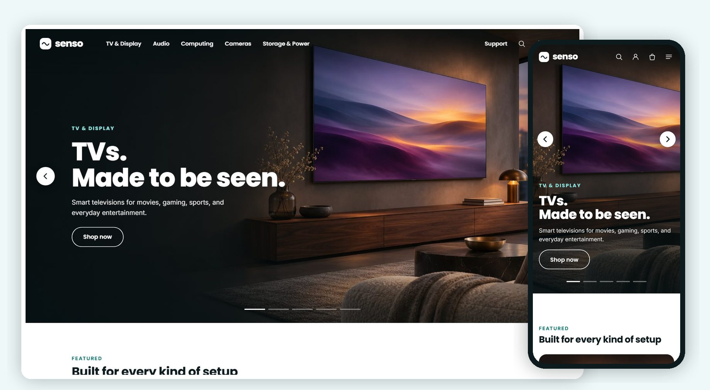

# Senso Electronics

**Senso Electronics** is a custom storefront **Layout** for Selldone shops: a single-seller electronics shop built like a big deals hub — a blue header with a category mega menu, a photo hero beside the Deal of the Day, two even rows of round categories, deal rails with an Add to cart that turns into − n +, doorbusters, a best-seller bento, category pages with a filter panel, a three-column product page, a side-by-side compare page and a receipt-first cart. It runs on **[senso.selldone.shop](https://senso.selldone.shop)**, an address of the shop Digini that carries its own Layout (see [Go Live](Go-Live)). It is built on the official [selldone/storefront](https://github.com/selldone/storefront), so Selldone's cart, checkout, payments and orders keep working underneath a completely new design.

## Start here

| I want to… | Page |
| --- | --- |
| Have an AI agent set it up on my shop | **[Install with AI](Install-with-AI)** |
| Set it up myself | [Manual Setup](Manual-Setup) |
| Know what my shop's data needs | [Shop Requirements](Shop-Requirements) |
| Build, upload and verify a release | [Build and Upload](Build-and-Upload) |
| Put it live on my shop and domain | [Go Live](Go-Live) |
| Change the name, colours, photos, sections, pages | [Customize](Customize) |
| Fix a problem | [Troubleshooting](Troubleshooting) |

## How a Selldone Layout works (one minute)

1. A **Layout** is a complete storefront app (Vue 3) that runs on Selldone's own servers instead of the default storefront.
2. You build it, zip it, and **upload** it to your Selldone developer account with the official [selldone-cli](https://github.com/selldone/cli). Each upload is a new **version**.
3. You **attach** a version to your shop, or to one of its domains. Every domain of the shop can inherit it.
4. Selldone injects **your** shop into the Layout: its products, categories, prices, deals, tags, theme, languages and settings. Nothing about Digini is hard-coded; the Layout's own name is one line.

## What you get

- **Home:** a photo hero with the Deal of the Day ("Next deal in", to midnight), Shop by category, Top deals, Doorbusters, your tags as "<Tag> Items" rows, a Best sellers bento, Gear for every moment, Trending, Shop by budget, New arrivals, Shop by brand and the newest articles.
- **Cards:** colour swatches that pick what "Add to cart" adds, capacity chips, a red "Save $X" and "Was $Y", "Add to cart" that turns into "− n in cart +" in place, "Choose capacity" for capacities with their own price, Compare and Save.
- **Category, search and deals pages:** a short head, a filter panel built from your category's specs, one sort menu, five cards a row.
- **Product page:** gallery · product · sticky buy card, then Specifications, Reviews, Frequently bought together and More in the category.
- **Compare:** side by side, differences on a yellow ground.
- **Cart and checkout:** a receipt-first drawer and cart page, a map-first address sheet, Delivery method tiles, an order summary that leads to whatever is missing.
- **Orders, account, sign-in, About, Contact, FAQ, Terms, Privacy, blog, 404.**
- **No seller interface:** one shop sells everything.

## Links

- Live shop: <https://senso.selldone.shop>
- Repository: <https://github.com/selldone-custom-layouts/official-senso>
- What Senso changed and its release log: [`SENSO.md`](https://github.com/selldone-custom-layouts/official-senso/blob/main/SENSO.md); every shared behaviour: [`KALIO.md`](https://github.com/selldone-custom-layouts/official-senso/blob/main/KALIO.md)
- All official custom Layouts: <https://github.com/selldone-custom-layouts>
- Selldone: <https://selldone.com>
